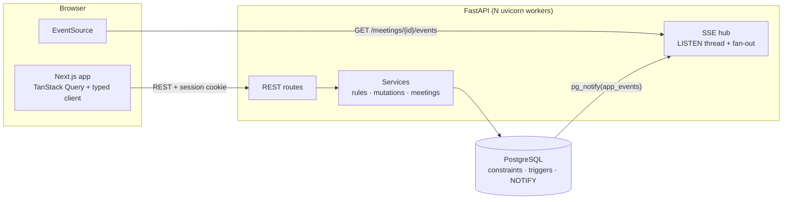
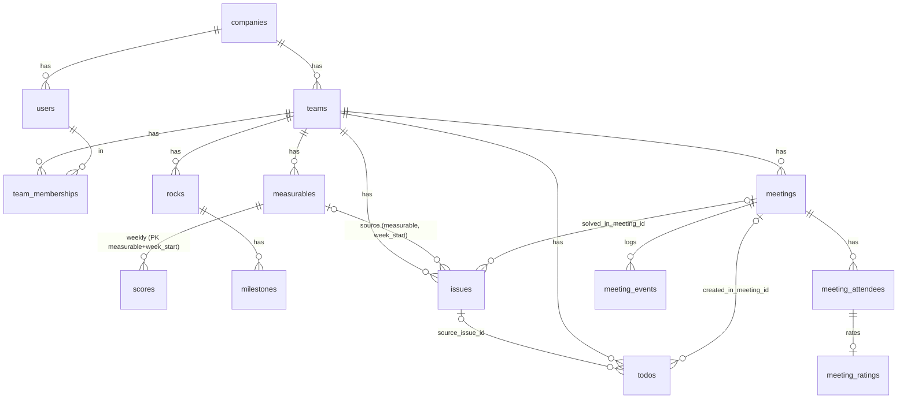
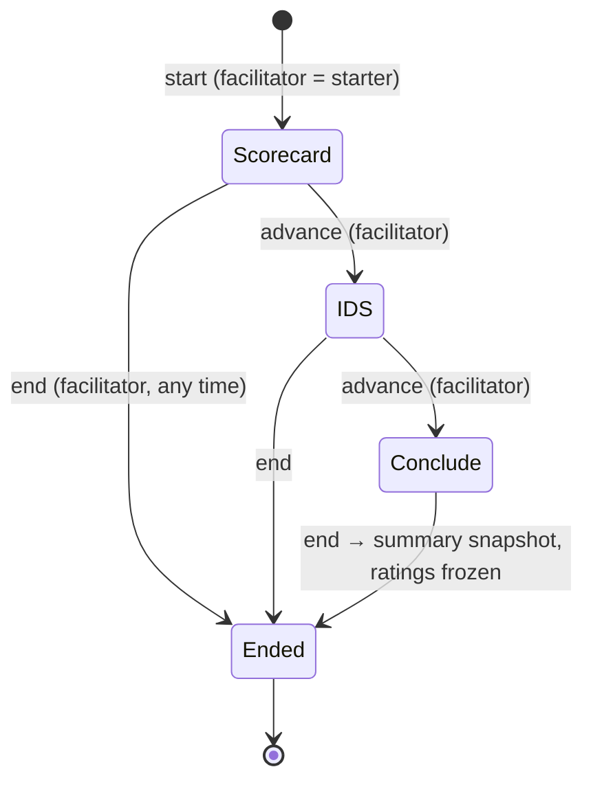

# Architecture

## Components

Backend layout (`backend/app`): `routes/` (HTTP only) → `services/` (use cases, transactions) → `rules.py` (pure
business rules, no I/O, no clock) with `models.py`/Alembic for persistence, `auth.py` (authentication + authorization),
`clock.py`, `realtime.py`, `seed.py`, `cli.py`. Frontend (`frontend/src`): `app/` routes, `features/` (scorecard, issues,
todos, rocks, meeting), `components/ui` (shadcn-style primitives), `lib/` (API client generated from OpenAPI, queries).

## Data flow

1. A mutation is a REST call with the session cookie. The route resolves the principal (user + memberships **from the
   database**), authorizes (`require_team_read/write`), and calls a service.
2. The service runs one short transaction, writes to PostgreSQL and queues `pg_notify('app_events', …)`; the notification
   is delivered only on commit.
3. Every backend process runs a hub: one thread holds a `LISTEN app_events` connection and passes payloads to the
   event loop, which loads the fresh meeting state once per event and pushes it to that process's SSE subscribers. So any
   worker's change reaches every browser, whichever worker holds its stream.
4. The browser updates its TanStack Query cache from the pushed state (or invalidates the affected team queries for
   `data_changed` events). Server state is never copied into component state.

## Database relationships

Key integrity rules enforced **in PostgreSQL**: week columns must be Mondays; Issue source needs both measurable and week
and belongs to the same team (composite FK); one unsolved Issue per measurable+week (partial unique index); solved ⇔ note
present; one active meeting per team (partial unique index); ratings 1–10, only by attendees, never by Observers, immutable
after the meeting ended (trigger); item owners must be Admins/Team Members of the team (trigger); a meeting is `ended`
iff `ended_at` and `summary` are set.

## Authentication

Simplified assessment login: `POST /api/auth/login {user_id}` sets an HMAC-signed, HttpOnly, SameSite=Lax cookie
containing only the user id. Roles/teams are reloaded from the database on every request. **Limitation:** no passwords —
any visitor can pick any seeded user; a production system would put an identity provider behind `current_principal`.
Cookie secret comes from `SESSION_SECRET` (a dev default is in config; not a real secret).

## Authorization

| Rule | Enforcement |
|------|-------------|
| Read a team | admin, or membership; unknown and foreign ids both give 403 (no enumeration); admins get 404 for unknown ids |
| Write | admin or team_member (`require_team_write`); observers always 403 |
| Entity belongs to path team | every lookup filters by `team_id` → 404 otherwise (a member of two teams can't modify team A's entity through team B's URL) |
| Meetings | authorize via the meeting's team; facilitator-only transitions; rating needs attendance and non-observer role |
| Owners | validated in the API (422) **and** by DB trigger |
| Request bodies | `extra="forbid"` — a client cannot smuggle `role`, `owner_id` (on Issue creation) etc. |

## Real-time synchronization

SSE + REST (see `DECISIONS.md`). `GET /api/meetings/{id}/events` first subscribes to the hub, then sends the full
`state` event, then streams `state` (meeting changed), `data_changed` (scorecard/issues/to-dos changed in this team)
and `resync` (listener reconnected / queue overflow) events; 15 s keep-alive comments. `id:` is the meeting version.
Clients ignore states with a lower `version` than they hold, so duplicates and reordering are harmless. The browser
also drops the stream on the `offline` event and reconnects on `online`; every connect starts with a full state.
Mutations use normal REST calls (so authorization, validation and error handling are identical to the rest of the API).

### Timer and clocks

Business rules use the **business clock** (frozen `APP_NOW`). Meeting timestamps/timers use the **timer clock** (real
UTC) because elapsed time cannot be measured by a frozen clock. The server computes `section_elapsed_seconds` from
`section_started_at` (persisted) and sends `server_time`; the browser adds only a local monotonic delta
(`performance.now()`) to the value it received, so **client wall clocks never matter**, and refresh/late-join/reconnect
produce the right value from the database. Overrun is `overtime_seconds = max(0, elapsed − planned)`; nothing advances
automatically.

## Meeting state lifecycle

All transitions: `SELECT … FOR UPDATE` on the meeting row, validate (facilitator / active / optional
`expected_version`), mutate, `version += 1`, append `meeting_events`, `pg_notify`. Joins and ratings also bump the
version (so every client-visible change is ordered).

## Error handling

Envelope `{"error": {"code", "message", "details"}}` for 401/403/404/409/422/500; unexpected errors are logged
server-side and returned as a generic 500 (no stack traces). `IntegrityError` safety net → 409. The frontend maps every
failure to a visible message (inline errors in forms, toasts for background mutations); network failures become one
consistent "cannot reach the server" message; the SSE connection badge shows connecting/reconnecting.

## Operational considerations

* `docker compose up`: `db` (healthcheck) → `init` (one-shot `migrate` + idempotent `seed`) → `backend` (healthcheck,
  2 uvicorn workers to exercise cross-worker propagation) → `frontend`. No sleeps.
* Seed: `ON CONFLICT DO NOTHING`; never resets data or overwrites user edits. Test reset is a separate guarded path.
* Images pinned by digest; dependencies exact + lockfiles; CI uses the same Pixi tasks.
* Observability: structured logging via stdlib; `/api/health` checks the database.
* Scaling (bonus note): see `DECISIONS.md`.

## Meeting-attributed mutations vs. ending a meeting (locking protocol)

Creating a To-Do or solving an Issue "in" a meeting (`meeting_id` supplied) used to read the meeting without a lock, so
under READ COMMITTED it could pass the "meeting is active" check, lose a race to `end` (which snapshots the summary and
commits), and then commit a To-Do/solved Issue tagged with an ended meeting that its immutable summary never listed.

Fix, all in PostgreSQL: `mutations._validate_meeting` takes `SELECT … FOR SHARE` on the meeting row (held to commit) and
re-checks `status`; `meetings.end` (like `join`, `advance`, `rate`) takes `FOR UPDATE` on the same row.

- Mutation first: `end` waits for in-flight attributed mutations, so the snapshot includes every committed one.
- `end` first: the mutation waits, re-reads the committed row (`populate_existing`), sees `ended` and fails with 409
  `meeting_ended`; nothing was written, so no partial rows exist.
- Attributed mutations share the lock (no mutual serialisation); mutations without `meeting_id` take no meeting lock.
- Lock order is always meeting row → Issue row; `end` only locks the meeting, so there is no cycle/deadlock.
- Transactions stay short (one request each); NOTIFY is queued in the transaction and fires only after commit.
- Ratings are accepted only in the Conclude section (409 `rating_not_open` otherwise) and, like every transition, run
  under the meeting row lock, so a rating cannot slip in after `end` either (DB trigger as a second line of defence).

Tests: `backend/tests/test_meeting_summary_race.py` (both interleavings × To-Do / solve / Issue, deterministic gates and
`pg_stat_activity` lock-wait polling instead of sleeps).

## Extended decision notes (full text of the decision record)
**1. Data model and source links.** A normalized PostgreSQL schema (companies, users, teams, memberships, measurables,
scores, rocks, milestones, issues, todos, meetings, attendees, ratings, meeting_events) with the original seed ids as
text primary keys. A score is a row per (measurable, `week_start`), where `week_start` is the company-local Monday (CHECK
ISODOW = 1), so weeks never depend on time-zone arithmetic in SQL. An Issue links to its source with two columns
(`source_measurable_id`, `source_week_start`) plus a composite FK `(source_measurable_id, team_id)` so a source must be a
measurable of the same team; a To-Do links with `source_issue_id` (composite FK on team too). I chose "reference columns
on the child" over a polymorphic `source` table because the only source type in scope is Measurable+week and constraints
(including the duplicate guard below) stay simple; adding Rock/To-Do sources later means adding nullable source columns
or a `source_type` and widening the index. Integrity lives in the database: CHECK constraints, partial unique indexes and
triggers (owners are never Observers; ratings immutable after the meeting; observers can't rate). Timestamps are
`timestamptz` (UTC); due dates are `date`.

**2. API design.** Resource-oriented REST under `/api`, team-scoped (`/teams/{id}/scorecard|issues|todos|rocks|meetings`)
plus `/meetings/{id}/…` for lifecycle verbs (`join`, `advance`, `end`, `rating`). Commands that are not simple CRUD
(`solve`, `complete`, Make it an Issue) are explicit sub-resources/verbs so they can be idempotent and validated. Make it
an Issue returns 201 (created) or 200 (existing). One error envelope for 401/403/404/409/422; foreign/unknown team ids
both give 403 for non-admins to avoid enumeration. Bodies are strict (`extra=forbid`), the OpenAPI document is the
contract and generates the frontend's TypeScript types, so there are no hand-maintained duplicate types. Trade-off: more
endpoints than a generic PATCH, in return for clearer authorization and semantics.

**3. Real-time transport and state recovery.** Server-Sent Events for server→browser pushes, ordinary REST for all
mutations, with PostgreSQL as the only owner of meeting state (section, facilitator, attendees, ratings, timestamps,
`version`, event log). WebSockets would add a custom protocol, manual reconnect/auth and bidirectional state that this
app doesn't need; SSE auto-reconnects and works with cookies. Every connect (first, refresh, late join, reconnect, the
facilitator's too) begins with a full authoritative `state` event, so recovery is "reconnect and read", with no replay
log. Mutations `NOTIFY` inside their transaction and each backend worker `LISTEN`s, so multiple workers/instances stay
consistent without sticky sessions. Transitions lock the meeting row and bump a monotonic `version`; clients drop stale
or duplicate states and the facilitator's requests can carry `expected_version` to reject stale actions. The timer is
computed on the server from a persisted `section_started_at`; browsers only add a local monotonic delta. Trade-offs: LISTEN/NOTIFY
payloads are small (ids only; state is reloaded per event), and `APP_NOW` is frozen so elapsed time uses a separate real-time
clock (documented in `ARCHITECTURE.md`).

**4. Duplicate-free Make it an Issue under concurrency.** A partial unique index `uq_issues_open_per_source ON
issues(source_measurable_id, source_week_start) WHERE solved_at IS NULL` makes duplicates impossible, and the service does
`INSERT … ON CONFLICT DO NOTHING RETURNING id`; if nothing was inserted it reads the existing unsolved Issue (retrying
once if it was solved in between). There is no check-then-insert window, no locks held, and the loser sees the winner's
row — both callers get the same Issue and no constraint error reaches the client. Solving the Issue frees the slot, so a
new one can be created later. The same pattern backs "one active meeting per team". Verified with 12 real concurrent HTTP
requests against PostgreSQL.

**5. Keeping past meeting summaries unchanged.** Implemented as a persisted **snapshot**: when a meeting ends the server
computes the summary (statuses for the reviewed week, solved Issue ids, created To-Do ids, attendees, rating) and stores it
as JSON on the meeting row (`ended ⇔ summary NOT NULL`); the API and report read the stored value and never recompute it, so
later score/Issue/To-Do edits cannot rewrite history. Issues and To-Dos are tied to their meeting by explicit FKs
(`solved_in_meeting_id`, `created_in_meeting_id`) captured at action time (seeded history is linked by timestamp window
at load). Trade-off: a snapshot is not re-derivable if rules change; that is the intent for history. (Event log
`meeting_events` provides an additional audit trail.)

**Scaling to 1,000 companies (note).** Add `company_id` to every table (it already exists on users/teams) with composite
unique/FK keys and Postgres row-level security keyed by a session setting; partition hot, time-ordered tables (scores,
events) by company or time; shard by company only if one database saturates. Keep the SSE hub per process with
LISTEN/NOTIFY partitioned by company-specific channels (or move to a broker) and move `meeting_events` consumption to a
queue if fan-out grows; run N stateless workers behind a load balancer (the design already has no per-worker state).

**Simplifications and their cost.** Seeded-user login has no passwords. The business clock is frozen (a feature for
determinism, a limitation for a real deployment). Bonus items done: lost-update protection (scores, Issue priority) and a
meeting event log; not done: Issue from Rock/To-Do, full audit trail.

